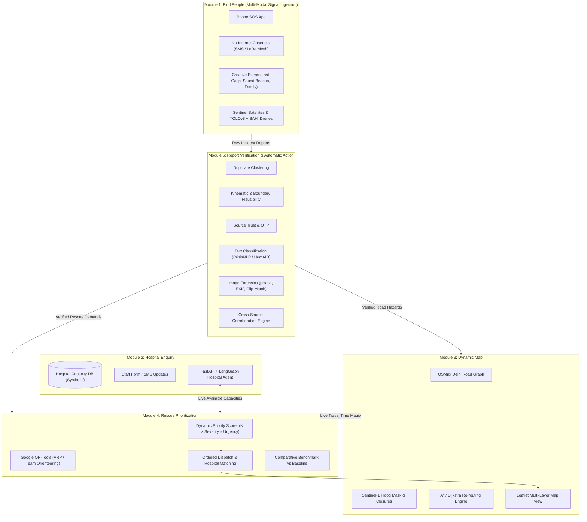
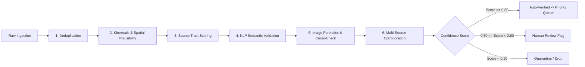

# DisasterOps AI — System Modules Specification

This document provides the architectural and functional specification for the core modules of the **DisasterOps AI** platform (Agentic AI-Driven Disaster Response and Emergency Resource Allocation).



---

## Module 1: Find People (Signal Ingestion & Detection)

### 1. Purpose
Collect and capture every possible distress signal indicating a person or group is in danger across all available channels—from active user reports and low-bandwidth radio meshes to passive drone and satellite observations.

### 2. Core Channels & Capabilities

#### A. Phone SOS Application (Primary Interface)
* **Single-Tap State Toggle:**
  * **Green (Safe):** Marked safe; auto-expires after a configurable TTL (e.g., 6 hours) requiring periodic check-in.
  * **Red (Needs Help):** Urgent distress flag; **help always overrides safe**.
  * **Yellow (Unknown / Expired):** Safe state expired or unacknowledged automated check-in.
* **Payload:** Geolocation (GPS coordinates + accuracy radius), timestamp, battery status, occupant count, and medical triage category.

#### B. No-Internet Resilient Communication Channels
* **SMS Gateway to Cloud Webhook:** Twilio/cellular webhook accepting structured or freeform distress SMS (`HELP <Lattitude>,<Longitude> <Needs>`).
* **LoRa Mesh Network (Meshtastic - IN865 Band):**
  * Hardware: ESP32 + SX1262 LoRa nodes deployed on emergency vehicles, shelters, and volunteer backpacks.
  * Protocol: Multi-hop mesh relaying compressed text packets over the Indian 865–867 MHz band directly to edge gateway relays without internet or cellular connectivity.

#### C. Creative Extras & Fail-safes
* **Low-Battery "Last-Gasp" Ping:** Automated background dispatch of the device's last known location and timestamp when battery falls below 5%.
* **Family Linking (Proxy Reporting):** Allows a registered family member or neighbor to report the status of dependents, children, or elderly persons without phones.
* **Acoustic Sound Beacon:** Triggerable high-decibel acoustic alert and screen strobe on registered mobile devices to assist physical search-and-rescue teams under debris or thick smoke.
* **Building Access Logs & Occupancy Footprints:** Integration with municipal RFID/turnstile badge logs to estimate trapped counts in collapsed commercial buildings.
* **Ward-Level Population Exposure Density:** Geospatial overlay cross-referencing census density with hazard boundaries to estimate baseline populations at risk.

#### D. Aerial & Orbital Remote Sensing
* **Sentinel-1 / Sentinel-2 Satellite Ingestion:** Synthetic Aperture Radar (SAR) Earth observation to detect water surface changes and define flooded or damaged polygons.
* **Autonomous Drone Search (YOLOv8 + SAHI):**
  * High-resolution aerial imagery parsed with **SAHI (Slicing Aided Hyper Inference)** to resolve tiny human targets from high altitudes.
  * **YOLOv8** object detection model fine-tuned on search-and-rescue aerial benchmarks (**HERIDAL** and **VisDrone**).

### 3. Output Schema (Raw Distress Report)
```json
{
  "report_id": "rep_9824f1c",
  "source": "sos_app | lora_mesh | sms_webhook | drone_yolo | proxy_family",
  "timestamp": "2026-11-21T12:00:00Z",
  "location": {
    "latitude": 28.6139,
    "longitude": 77.2090,
    "accuracy_meters": 12.5
  },
  "status": "red | yellow | green",
  "people_count": 3,
  "telemetry": {
    "battery_pct": 4,
    "is_last_gasp": true
  },
  "raw_content": "Trapped on roof, water rising rapidly"
}
```

---

## Module 2: Hospital Enquiry & Medical Coordination

### 1. Purpose
Provide real-time, grounded, and verified visibility into hospital and emergency shelter capacity to ensure emergency dispatch does not send victims to overburdened or under-equipped facilities.

### 2. Architecture & Implementation
* **FastAPI Backend + LangGraph Agent:** Implements an orchestrator agent using function-calling tools with strict zero-hallucination barriers.
* **Tool-Grounded Operations:**
  * `get_beds(hospital_id: str) -> BedStatus`
  * `get_icu(hospital_id: str) -> ICUStatus`
  * `get_ambulances(hospital_id: str) -> AmbulanceFleet`
  * `get_blood(hospital_id: str, blood_group: str) -> BloodReserve`
  * `get_medicines(hospital_id: str, medicine_category: str) -> SupplyStatus`
* **Hospital Staff Update Channels:**
  * Web form with PIN authentication.
  * Direct SMS structured parser for resource managers in low-connectivity areas (e.g., `HOSP102 ICU 4 BEDS 12 O_POS 8`).

### 3. Safeguards & Integrity Policies
* **Tool Grounding Enforcement:** The LLM is restricted from inventing, estimating, or predicting numbers. It may strictly emit figures returned by the database tools.
* **Freshness & Staleness Tracking:** Every metric displayed or spoken includes an explicit `last_updated_at` ISO timestamp.
* **Stale Data Warning:** Capacities older than a threshold (e.g., > 90 minutes) are flagged with an explicit warning banner: `⚠️ STALE DATA (Updated 110 min ago)`.
* **Triage & Facility Recommendation:** Recommends the optimal receiving facility using a multi-criteria score balancing:
  * Driving distance/transit time (from Module 3).
  * Available capacity in the required specialty (e.g., Burn Center, Pediatric ICU, Trauma Level 1).
  * Current queue/intake rate.

### 4. Data Specification
* Employs structured synthetic datasets modeled after public hospitals in the national capital region (Delhi-NCR) to ensure complete realism while avoiding privacy or operational restrictions.

---

## Module 3: Dynamic Map & Resilient Routing

### 1. Purpose
Maintain a live, accurate, and obstacle-aware topological model of the transport network to calculate feasible transit times during disaster conditions.

### 2. Core Components

#### A. Road Network Graph
* Road topology of Delhi generated and extracted using **OSMnx** from OpenStreetMap, modeled as a directed, edge-weighted graph $G = (V, E)$ via **NetworkX**.
* Edge attributes: physical length, speed limit, road classification (primary, secondary, residential), and estimated traverse time.

#### B. Dynamic Hazard & Closure Ingestion
* **Satellite Flood Masks:** Sentinel-1 SAR flood vectors converted to geospatial polygons. Any edge intersecting a flood polygon is flagged as submerged.
* **Verified Disaster Obstacles:** Landslides, fallen power lines, collapsed bridges, or debris identified by **Module 5** automatically trigger edge deactivation.
* **Manual Emergency Overrides:** Real-time administrative controls allowing field coordinators to close or reopen specific road links.
* **Edge Cost Updates:** Depending on water depth or congestion, edges are either completely severed ($w(e) = \infty$) or penalty-scaled with increased traversal impedance.

#### C. Routing Engine
* **A\* Search & Dijkstra Algorithms:** Executes rapid shortest-path and least-time path recalculations whenever graph topology changes.
* Generates live Origin-Destination (OD) travel time matrices for Module 4's dispatch solver.

#### D. Visual Mapping UI (Leaflet)
* Interactive multi-layer dashboard built with **Leaflet.js**:
  * Layer 1: Base OpenStreetMap road tiles.
  * Layer 2: Semi-transparent Sentinel-1 flood extent polygons (blue/red alerts).
  * Layer 3: Hospitals and Shelters (interactive pins showing live bed/ICU stats).
  * Layer 4: Victims / Distress Signals (color-coded dots: Red = Urgent, Yellow = Pending, Green = Safe).
  * Layer 5: Active rescue vehicle trajectories and assigned routes.

---

## Module 4: Rescue Prioritization & Resource Allocation

### 1. Purpose
Optimize the scheduling and assignment of rescue teams, emergency vehicles, and medical assets to maximize lives saved under strict resource constraints.

### 2. Mathematical Formulation & Priority Scoring

#### A. Priority Function
For each verified victim or incident $i$, a dynamic priority score $P_i(t)$ is computed:
$$P_i(t) = N_i \times S_i \times U_i(t)$$

Where:
* $N_i$: Number of confirmed individuals at the location.
* $S_i \in [1, 5]$: Clinical/environmental severity rating (e.g., 5 = structural collapse/submerged, 1 = minor injury).
* $U_i(t)$: Urgency decay factor modeling survival probability over time:
  $$U_i(t) = \exp(-\lambda_i \cdot (t - t_{0, i}))$$
  where $\lambda_i$ is the risk decay rate based on incident type and $t_{0, i}$ is report time.

#### B. Optimization Formulation
* **Model:** Formulated as a **Team Orienteering Problem with Time Windows (TOPTW)** or **Capacitated Vehicle Routing Problem (CVRP)** with heterogeneous vehicle capacities and hospital destination nodes.
* **Solver Engine:** **Google OR-Tools** (Constraint Programming / routing solver).
* **Constraints:**
  * Vehicle passenger/stretcher capacity limits.
  * Rescuer shift duration and battery/fuel constraints.
  * Road graph traversability constraints (Module 3 travel time matrix).
  * Destination hospital bed/ICU intake capacity limits (Module 2).
* **Output:** Deterministic, step-by-step ordered waypoints for every field unit with Estimated Times of Arrival (ETA) and designated hospital transfer destinations.

#### C. Continuous Dynamic Replanning
The solver triggers incremental re-optimization upon:
1. Receipt of newly verified high-priority distress reports.
2. Sudden road closures or flood boundary expansions.
3. Rapid drop in receiving hospital capacity.

#### D. Research Evaluation Protocol
* Simulation testbed running comparative benchmarks:
  * **Baseline:** Naive greedy algorithm (e.g., nearest victim first / FIFO).
  * **DisasterOps AI Engine:** Multi-agent prioritization + OR-Tools global optimization.
  * **Key Metrics:** Total estimated lives saved, average response time, resource utilization rate, and cross-zone fairness.

---

## Module 5: Report Verification & Automated Action

### 1. Purpose
Act as an automated intelligence gate between raw public signal ingestion (Module 1) and operational dispatch (Module 4), filtering out hallucinations, duplicate alarms, spam, and malicious misinformation before teams are deployed.



### 2. Multi-Signal Verification Pipeline

| Layer | Verification Method | Technical Implementation | Action / Output |
| :--- | :--- | :--- | :--- |
| **1. Deduplication** | Identify redundant reports from same event. | Sentence-Transformers embeddings (cosine similarity $> 0.88$) + spatial radius ($< 50\text{ m}$) + temporal window ($< 30\text{ min}$). | Merge duplicate records; increment confirmed people count without duplicating rescue tasks. |
| **2. Location Plausibility** | Validate spatial feasibility and physics. | Spatial intersection with active alert zones / flood boundaries; kinematic speed check ($v = \frac{\Delta d}{\Delta t} < 120\text{ km/h}$). | Flag teleporting reports; downweight coordinates outside affected districts. |
| **3. Source Trust** | Assess reporter authenticity and reputation. | Phone OTP verification status, historical report accuracy, rate-limiting filter (flags burst spamming $> 5\text{ reports/min}$). | Generate baseline trust weight $T \in [0.1, 1.0]$. |
| **4. NLP Text Analysis** | Classify distress intent and detect rumors/pranks. | Transformer classifier fine-tuned on disaster benchmarks: **CrisisNLP**, **CrisisMMD**, and **HumAID**. | Categories: `Urgent Request`, `Informational`, `Rumor/Hoax`, `Spam`. |
| **5. Image Forensics** | Verify submitted disaster photos. | EXIF metadata extraction (timestamp/GPS match), **perceptual hashing (pHash)** against web scrape databases to detect recycled images, and CLIP text-image alignment. | AI-generated detectors treated as weak indicators; recycled disaster imagery flagged immediately. |
| **6. Corroboration Engine** | Synthesize external multi-modal confirmation. | Spatial-temporal cross-referencing against nearby independent reports, drone YOLO detections, or satellite SAR flood boundaries. | Corroboration multiplier significantly boosts priority confidence. |

### 3. Automated Action Matrix
* **Confidence $\ge 0.80$ (High):** Verified automatically; passed immediately to Module 3 (road closures) and Module 4 (rescue prioritization).
* **$0.50 \le \text{Confidence} < 0.80$ (Medium):** Routed to the Field Dispatcher's human verification queue with pre-highlighted anomaly markers.
* **Confidence $< 0.50$ (Low / Anomalous):** Automatically quarantined into the audit log with no rescue resource commitment.

---

## Summary of Module Interfaces

| From Module | To Module | Data Handshake | Protocol / Transport |
| :--- | :--- | :--- | :--- |
| **Module 1** | **Module 5** | Raw distress reports, phone telemetry, drone bounding boxes | Internal Pub/Sub Queue |
| **Module 5** | **Module 3** | Verified road closures, debris locations, flooded segments | GeoJSON / Event Stream |
| **Module 5** | **Module 4** | Verified victim counts, location, severity, and urgency | Structured JSON Payload |
| **Module 2** | **Module 4** | Live hospital bed, ICU, and trauma intake capacities | REST / In-memory Tool Calls |
| **Module 3** | **Module 4** | Live Origin-Destination (OD) travel time matrix | NumPy / SciPy Distance Matrix |
| **Module 4** | **Module 3** | Optimized vehicle routes and hospital transport assignments | GeoJSON Polyline Overlay |

