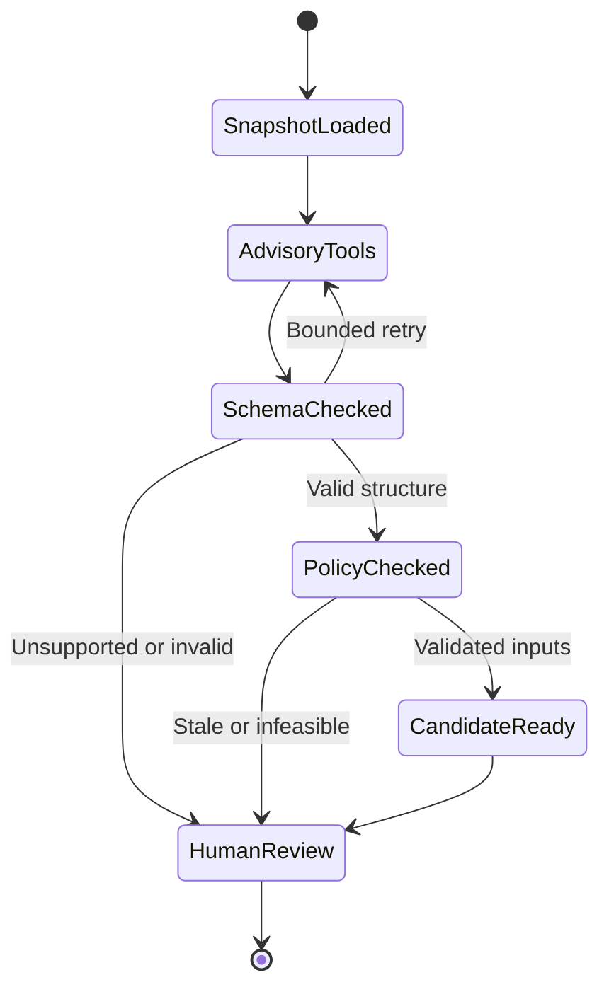
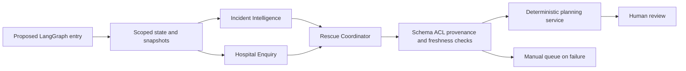

# Proposed AI agent design

No AI agent, model call, LangGraph workflow or optimizer is executable in the current application. Design these after deterministic contracts and evaluation are stable. See [Guardrails](GUARDRAILS.md).

| Agent | Input and state | Tool boundary and output | Failure, approval and evaluation |
| --- | --- | --- | --- |
| Incident Intelligence | Redacted report, timestamps, location uncertainty, evidence refs, report/version ID | Read approved evidence and plausibility results. Extract incident fields and cite support or contradictions. Keep unsupported values null. | On malformed output or outage retain raw report and send to manual review. Evaluate extraction, evidence attribution, and missed-critical rate with synthetic cases. A reviewer accepts or corrects findings. |
| Hospital Enquiry | Approved need categories, region, inventory/graph snapshot and freshness policy | Read facility capability and timestamped availability. Summarize candidate matches using exact tool values. | On missing or stale data label unknown. No reservations or invented capacities. Operator verifies suitability; evaluate numeric faithfulness and stale/unsuitable rate. |
| Rescue Coordinator | Approved incident requirements, trusted asset and capacity versions, route matrix, constraints | Read eligibility, snapshot and planning interfaces. Produce typed, reviewable proposals for deterministic compilation. | Report blocked constraints and fall back to manual planning on failure. No dispatch or mission writes. Evaluate compiled feasibility and operator overrides. |

All prompts separate instructions from report data, request schema-only outputs and require source references and uncertainty. Typed shared state should carry correlation ID, snapshot/version IDs, redacted evidence references, tool outcomes, validated suggestions, retry count, and final disposition. Keep raw evidence, credentials, private location and clinical details out of persisted model state unless separately justified and approved. Tools use service-side identity, JSON schema validation, time budgets, and scoped access. Audit redacted tool selections and outputs. Cap retries and route exhausted or contradictory cases to review.

Deterministic deduplication, location bounds, routing, capacity checks, optimization, and policy enforcement are services. A compiler resolves suggestion IDs against trusted snapshots, rejects unknown units/entities and stale references, and applies hard constraints independently. Verify solver output against route and capacity policy before showing it. Audit reviewer edits and disagreements. See [Testing strategy](../TESTING_STRATEGY.md).
