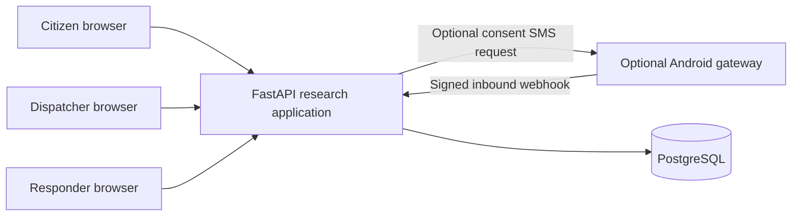
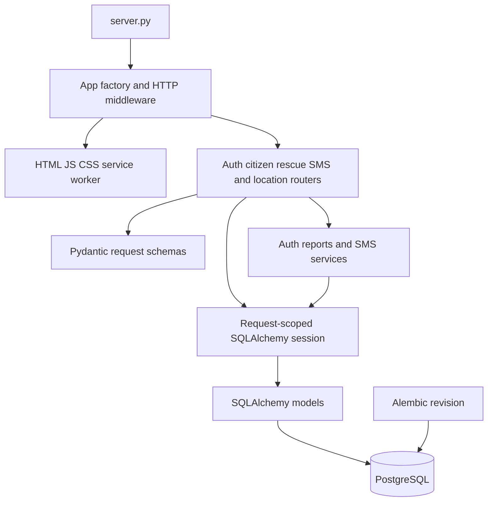
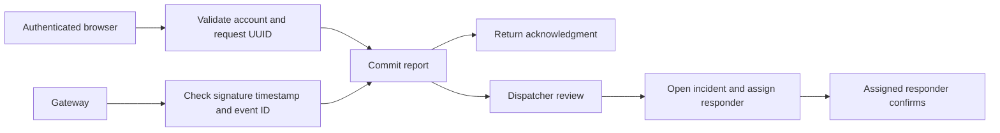
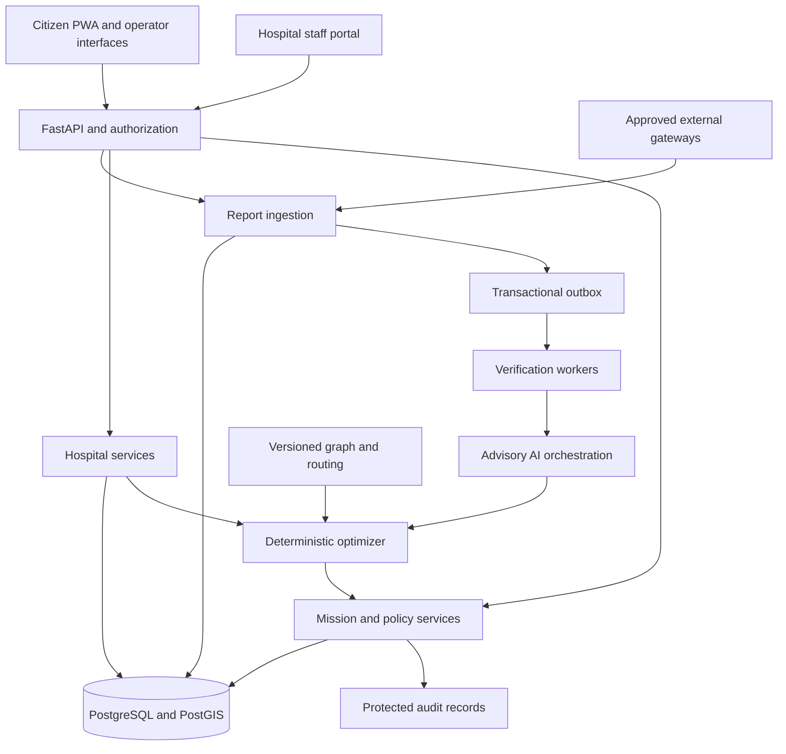
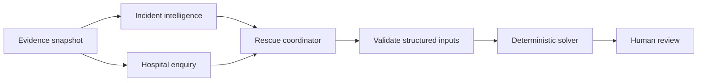
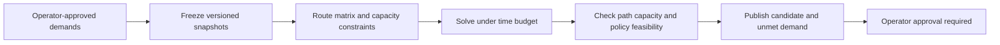
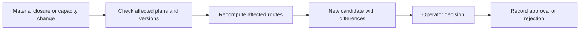
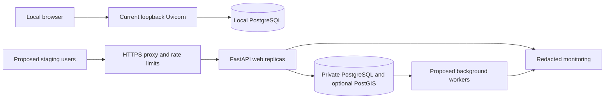

# Architecture

This document owns component structure. See [System design](SYSTEM_DESIGN.md) for behavior and [Deployment](DEPLOYMENT.md) for runbooks.

## Current system context

`server.py` hosts the modular monolith. [create_app](../disasterops/main.py) initializes the SQLAlchemy engine, serves same-origin HTML and assets, mounts API routers, and applies response headers and redacted logging. The service worker caches the public shell. Leaflet and base tiles are external browser resources. Gateway configuration and physical integration are optional.

The backend imports no browser code. Routers enforce roles, validate requests, and compose use cases. Services hold reusable session, report, and transport logic. Legacy `schema.sql` is excluded from the active migration path. Some operator workflows and persistence queries remain directly in routers.

## Current SOS flow

**Synchronous.** Browser API requests, database transactions, gateway webhook receipt, and the outbound consent-link request/response. The gateway accepts requests separately from carrier delivery. **Asynchronous in the current system.** Browser geolocation, service worker caching, carrier transport and independent inbound deliveries. Operators can refresh the queue and check consent status on demand. There is no durable job queue or scheduled dispatch worker.

## Proposed component architecture

The citizen PWA handles authenticated submission, drafts and check-ins. Operations and responder interfaces surface evidence, approvals and assignment progress. The hospital portal scopes inventory writes to a facility. PostGIS would store versioned spatial evidence. Workers consume durable events and emit review context. Approved adapters isolate provider failures. Keep the monolith until evidence justifies a deployment split.

## Proposed advisory flow and planning

## Deployment structure

In the target, reads and acknowledged writes remain synchronous. Durable verification and replanning would run asynchronously using event IDs, aggregate versions and retry policies. See [AI design](AI_AGENT_DESIGN.md) and [Data model](DATA_MODEL.md).
