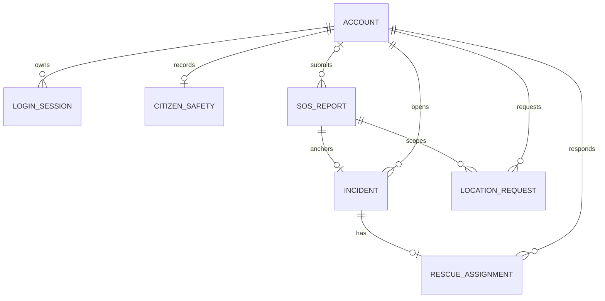
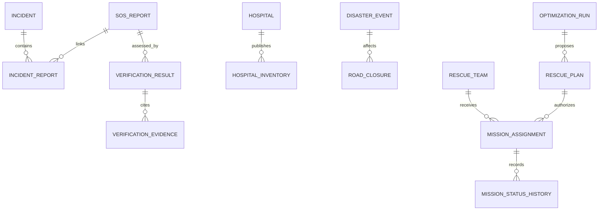

# Data model

The active sources are [models.py](../disasterops/models.py) and [0001_phase0](../migrations/versions/0001_phase0.py). PostgreSQL is required at runtime. Legacy [schema.sql](../schema.sql) is historical. Dates use timezone-aware UTC application timestamps. Entity IDs are UUID strings in the current database.

| Table | Keys and constraints | Fields, indexes and sensitivity |
| --- | --- | --- |
| accounts | id PK, unique username, role check | citizen/dispatcher/responder, Argon2id hash, nullable unverified phone. Unique username lookup. |
| login_sessions | token_hash PK, account_id FK with cascade delete | SHA-256 token digest, expires_at. Both account and expiry indexed. |
| citizen_safety | account_id PK/FK, checked SAFE or NEEDS_HELP | updated_at. No row means unknown. Separate from SOS. |
| sos_reports | id PK, nullable account FK, unique account/client_request pair, unique gateway_event_id | Coordinates both null or valid pair. Source, message, phone, battery, accuracy, received_at. Account and received time indexed. Raw reports are sensitive. |
| incidents | id PK, unique report FK, opener account FK | opened_at. No stored lifecycle status. |
| rescue_assignments | id PK, unique incident FK, responder and assigning account FKs | assigned_at and nullable confirmed_at. Responder indexed. Role and ownership enforced in API. |
| location_requests | id PK, report and requester FKs, unique token_hash | Both FKs indexed. Expiry, submission time, and consented coordinates. Only the requesting dispatcher can retrieve the result. |

## Target model, proposed

| Entity group | Relationships and constraints |
| --- | --- |
| Users, roles and citizen profiles | Keep auth identity separate from optional profile. Scoped role grants reference account and organization. Check-ins may retain history and have effective expiry. |
| Reports and incidents | Incident-report join preserves each original report and reviewer rationale. Verification result references report and version; evidence is immutable and independently attributable. |
| Hospitals and inventories | Hospital has specialties, staff grants, timestamped capacity/inventory records and reservations. Non-negative quantities, validity/freshness and transactional capacity constraints. |
| Rescue teams, vehicles and resources | Team membership, equipment, shifts, capacities and availability intervals. Reserve resources under concurrency control. |
| Disaster events and closures | Event owns hazard observations. Road closure links graph edges to version, provenance, effective range and reviewer. Store geographic points and hazard geometries with explicit CRS, plan GiST indexes based on queries. |
| Optimization runs and rescue plans | Run references immutable input snapshots, parameters, solver status, objective and budget. Plan variants point to run. Approval refers to a plan version and actor. |
| Missions and history | Assignment references approved plan and team. Append timestamped transitions, reject invalid jumps, keep completion evidence. Notifications reference events with deduplication and delivery status. Audit events reference actor, target, reason and correlation ID without raw secrets. |

Proposed vocabularies include verification pending/reviewed/uncertain, plan candidate/approved/superseded, and mission acknowledged/in progress/completed/interrupted. Choose stable enums and explicit transition policy before migration. Store coordinate precision and accuracy separately. Define retention per data class, expiry versus deletion, backups, audit redaction and incident-hold exceptions before using real personal data. Current consent expiry limits submission and does not purge rows. Use Alembic expand/backfill/validate/contract with compatibility windows, rehearse on synthetic data, and require approval for destructive changes. See [Security](SECURITY.md) and [Decisions](DECISIONS.md).
