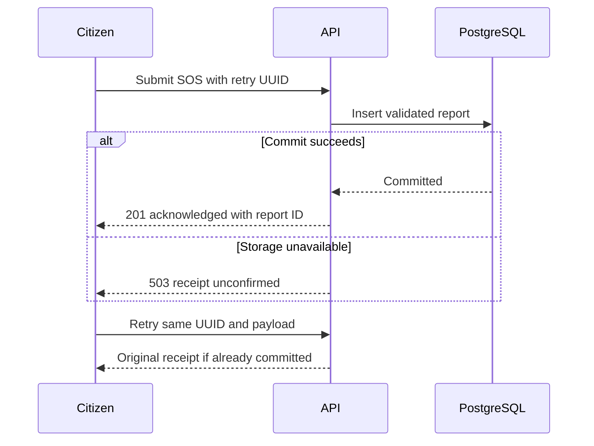
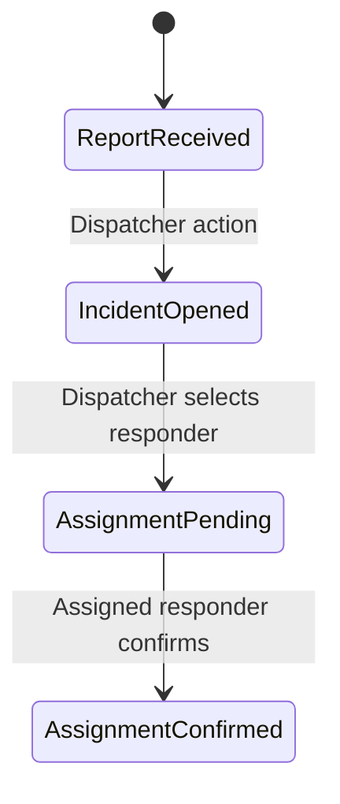
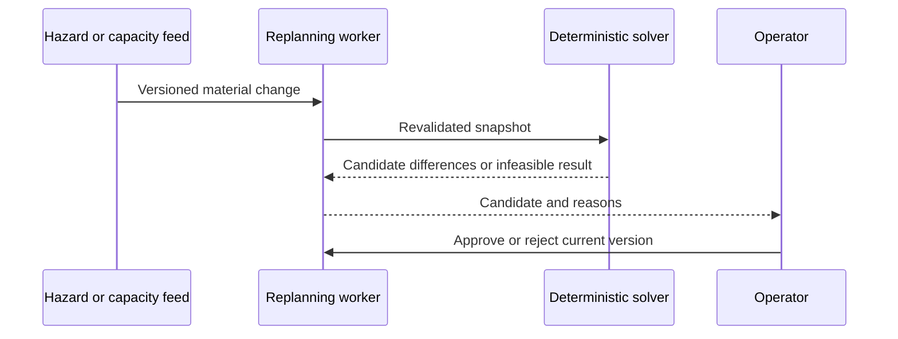
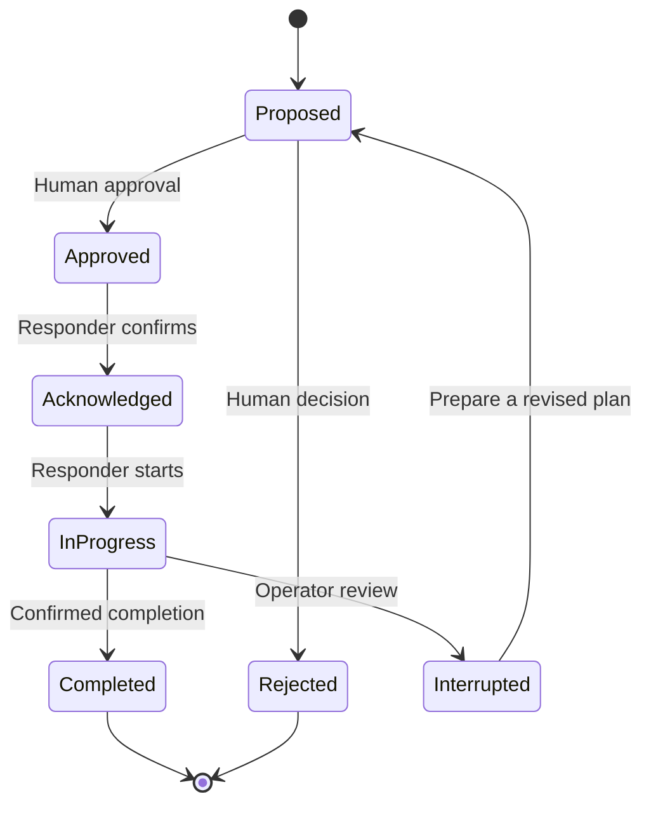

# System design

This document describes behavior and trade-offs. [Architecture](ARCHITECTURE.md) owns structure. [Requirements](REQUIREMENTS.md) owns acceptance IDs.

## Current workflows

1. **Registration.** `auth.register` normalizes the username, validates optional phone and password, hashes the password, and commits the citizen account. Login issues a revocable cookie. Staff accounts are provisioned locally via `disasterops.provision`.
2. **SOS.** The browser tries GPS and can submit without it. `record_sos` scopes the retry UUID to the authenticated citizen and checks repeat payloads. A safe check-in is independent and cannot erase distress history.
3. **Offline SMS.** The browser drafts a message to the configured project SIM. The sender presses Send. The receiver verifies raw bytes and timestamp, parses the signed event, and commits once per gateway ID. A report lacking coordinates remains visible.
4. **Incident creation.** The dispatcher reviews intake and explicitly opens an incident. Unique constraints enforce one incident per report.
5. **Hospital enquiry.** `renderHospitals` displays synthetic, static examples. It has no database or recommendation call.
6. **Operator approval and assignment.** A dispatcher names an existing responder. The assignment is pending until that responder confirms. The confirmation write locks the assignment row and preserves the original timestamp on repeat. No mission tracking or resolution exists.

Consent link creation commits a request before contacting the gateway. Acceptance is separate from delivery. A conditional update enforces one submission before expiry. Status lookup is scoped to the requesting dispatcher. There is no transactional outbound queue, so ambiguous sends require care before retry.

## Proposed workflows

| Flow | Trigger, processing and recovery |
| --- | --- |
| Report verification | Attach provenance and evidence to raw report, compare plausible duplicates, present uncertainty, and preserve report on tool failure. Reviewer links or escalates with a reason. |
| Hospital enquiry and reservation | Authorized staff publishes a scoped capacity snapshot. Filter by verified capability and freshness, then reserve transactionally with expiry and a separate confirmation. Missing capacity yields unknown. |
| Road closure update | Ingest a time-bounded observation, validate geometry and authority, obtain review, and publish a new graph version. Reject malformed changes and retain prior snapshot. |
| Rescue optimization | Snapshot demand, teams, routes and facility availability. Build constraints, solve within a budget and validate output. Surface infeasibility and unmet demand for review. |
| Operator approval and mission assignment | Compare candidate version to current inputs, approve with a reason, reserve scarce resources atomically, assign, and require responder acknowledgment. Recheck versions on conflict. |
| Rescue tracking and resolution | Collect scoped, consented and timestamped mission updates. Stale signals remain unknown. Record completion or interruption, reconcile reservations, and close with a reason and actor. |
| Dynamic replanning | Coalesce relevant events, assess effect on approved work, recalculate candidate routes, and compare versions. Operator approval is needed for any change affecting an active assignment. |

## Engineering properties

| Property | Current and target |
| --- | --- |
| Availability and fault tolerance | Current startup needs PostgreSQL and a migrated accounts table. No HA or queue. Target health checks, tested restore, redundant web instances and durable workers. Set availability goals only after baseline measurements. |
| Reliability and consistency | Current unique constraints and transaction commits protect receipt and retries. PostgreSQL row locks serialize safety and confirmation updates. Target outbox and version checks make side effects observable and stale planning inputs detectable. |
| Performance and scalability | Current queues use 50-item offset pages with additional workflow queries. Measure latency and query count before batching joins, introducing cursor pagination, or adding workers. |
| Retries and recovery | Retry uncertain SOS with the same payload and UUID. Conflicts are caller errors. Proposed worker retries use jitter, a bounded budget and a review queue for exhausted attempts. Never treat repeated delivery as evidence of independent corroboration. |
| Caching | Cache the public shell and project SIM only. Target graph and inventory caches use versioned keys, validity time, and access isolation. |
| Observability and security | Current structured request ID, route, status and database error class. Target protected audit events, queue lag, receipt latency, error rates, backup checks and alerts. See [Security](SECURITY.md). |
| Simulation boundaries | Use synthetic accounts, location traces and resource availability. A simulated mission is visibly labeled and isolated from external dispatch and production channels. |

See [Testing strategy](../TESTING_STRATEGY.md) for negative tests and evaluation.
